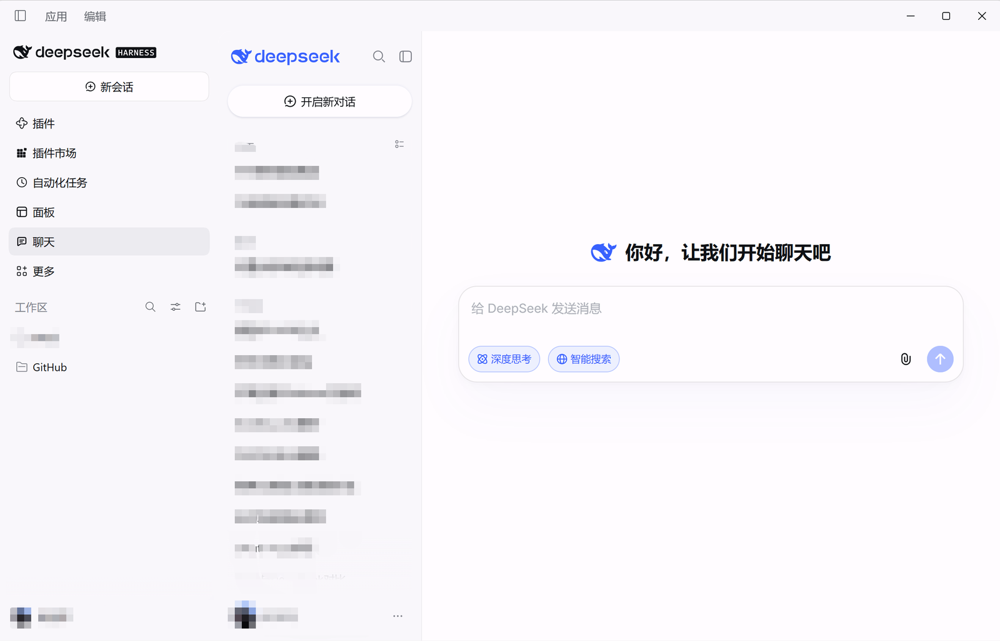
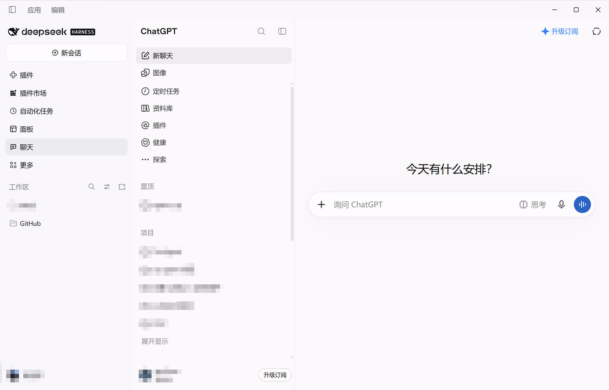
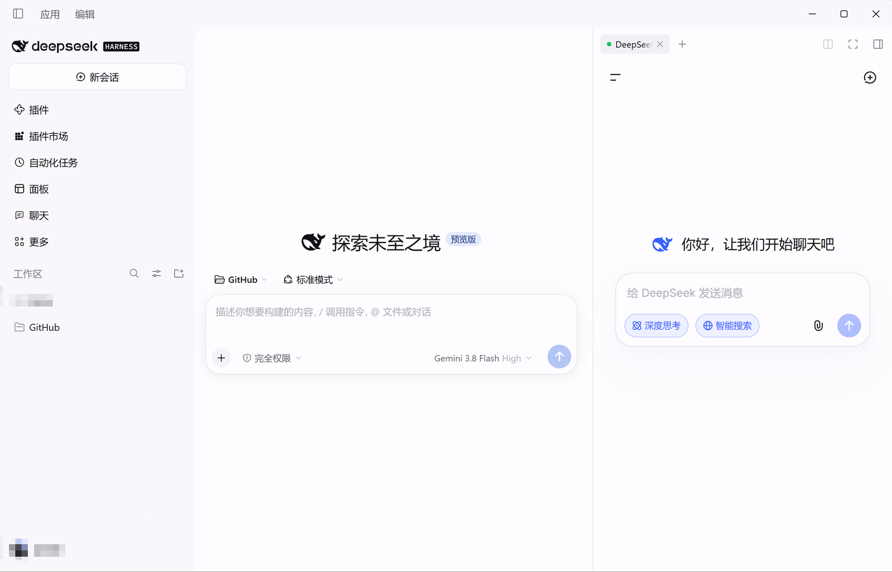
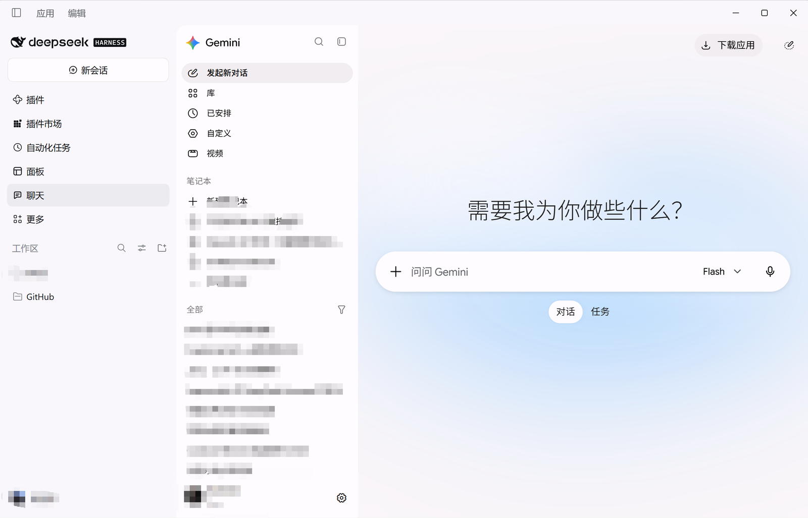
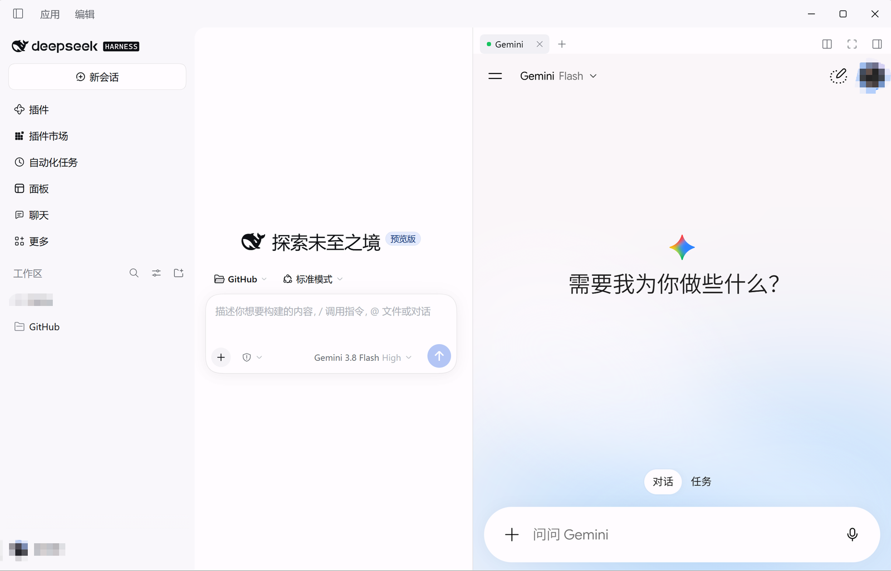

# dsh-chat-embed

在 **DeepSeek Harness（dsh）桌面版**里开一个**多标签 AI 聊天面板**。

左侧导航有「聊天」入口，点开后**中央主面板就是聊天页**：顶部一排标签 —— DeepSeek、豆包、ChatGPT、MiniMax、Kimi、Gemini、Grok —— 每个标签是一个真实的桌面 webview，**各自独立登录**；切标签不重载页面。同一个聊天页也能放到**右栏**（会话头「⧉」按钮 / 右栏启动器），两处互斥，**哪边点哪边接管**。



---

## 项目名称与组成

| 名称 | 说明 |
| --- | --- |
| `dsh-chat-embed` | 本插件的包名，也是 dsh 插件管理器里的条目名 |
| `index.js` | **Host 半侧**（Node）：当前是空壳，只为满足 bundle 的 loader 行；后续若需 Host 配置从这扩展 |
| `client.js` | **Client 半侧**（浏览器）：多标签、租约握手、内联席位、全部 UI。手写产物，无构建 |
| `locale/{en,zh}.json` | 插件管理器里显示的标题与简介 |
| `cordis.patch.yml` | 组合补丁：向 profile 插入 `id: chat-embed` 的 loader 行 |
| `scripts/verify-bundle.mjs` | 门禁：语法 / 清单 / loader 契约 / 服务注册表 / 显示资源 |
| `test/` | 纯 Node 契约测试（伪造 DOM + 伪造桌面桥 + 伪造 asar），81 项 |
| `docs/architecture.md` | 内嵌契约、席位架构、壳补丁、升级复验清单（**接到项目先读这份**） |
| `tools/shell-patch/` | 可选的桌面壳补丁：持久分区（跨重启免登录）+ 关闭磁盘缓存 |
| `清理聊天缓存.cmd` / `restore-shell-patch.cmd` | 缓存回收 / 还原原版壳 |

**没有第三方运行时依赖**：`client.js` 直接由 dsh 的模块加载器执行，React 用壳共享的那一份。

### 文档入口

| 想了解 | 读哪里 |
| --- | --- |
| 怎么装、怎么用 | 本文件（README） |
| 为什么这样实现、内嵌契约、升级外壳时的复验清单 | `docs/architecture.md` |
| 壳补丁（持久分区 / 关缓存）与回滚 | `tools/shell-patch/` + `restore-shell-patch.cmd` |
| 门禁与测试覆盖了什么 | `scripts/verify-bundle.mjs`、`test/client.test.mjs` |
---

## 软件定位与功能

**定位**：给 dsh 桌面版补上一个"多服务 AI 聊天"的常驻界面。不代理请求、不保存聊天内容，只是把各站点装进独立登录态的桌面 webview。

| 能力 | 说明 |
| --- | --- |
| 左栏「聊天」→ 中央主面板直接是聊天页 | 顶部多标签切换，每个服务独立 webview、独立分区 |
| 右栏聊天 tab（`keepMounted`）+ 会话头「⧉」 | 切标签不卸载，页面状态保留 |
| 哪边点哪边接管 | 左栏入口 / 右栏 tab 谁被点开谁承载；互斥，切换重建一次并回到上次会话 |
| 7 个内置服务 | DeepSeek、豆包、ChatGPT、MiniMax、Kimi、Gemini、Grok；改 `PROVIDERS` 一行即可扩展 |
| 标签常驻 | 切标签只切 `data-active`（`display:none`），草稿与滚动位置保留 |
| 失败隔离 | 单个标签失败不影响其它；「重新加载」只换该标签的租约 |
| 拖动排序 | 按住标签横向拖动（>6px 才算拖动），顺序写 `localStorage`；溢出时滚轮横向滚动 |
| ⚙ 设置 | 逐个启用/禁用服务，至少保留一个，状态持久化 |
| 诊断（⚙ 菜单） | URL / 分区 / 阶段 / 右栏注册 / 席位 / 自检，一键复制 |
| 调试日志（⚙ 菜单） | 默认关闭；开启后控制台输出插件事件，菜单里可「复制日志」 |
| 原生布局跟随 | 聊天页放在席位布局盒里，宽高由 CSS 决定；拖分隔条零 JS、零重渲染 |
| Google 登录死路 / 非桌面环境 | 自动退回入口并给出说明卡片；Web GUI 下显示说明 + 外开链接 |

---

## 截图

| 左栏：中央面板多标签 | 右栏：聊天 tab |
| --- | --- |
|  |  |
|  |  |

## 快速开始

### 环境要求

| 项 | 要求 |
| --- | --- |
| 桌面端 | `@deepseek-ai/dsh-desktop 0.2.2-rc.1`（实测；Windows 10/11） |
| Node.js | `>= 22`（仅开发/测试需要，插件运行时不依赖 Node） |
| 浏览器/壳 | Electron（`webviewTag` 开启）—— Web GUI 只能用降级卡片 |

### 安装（5 行）

> 仅桌面版可用（需要 Electron 的 `<webview>` 和 `window.dshDesktop.browser`）。
> 当前实测版本：`@deepseek-ai/dsh-desktop 0.2.2-rc.1`；包声明了 `engines.dsh`，版本不符时插件管理器会拒绝安装。

**方式一：npm（已发布 `0.5.4`）**

```jsonc
// 在 dsh 会话里交给插件管理器执行
plugin_manager { "action": "install_bundle", "target": "dsh-chat-embed" }
// 然后刷新页面；左侧栏出现气泡图标即安装成功
```

```powershell
# 命令行等价写法
dsh plugin --profile desktop add dsh-chat-embed
```

**方式二：git 仓库或本地 tarball**

```powershell
# 从 Releases 下载 dsh-chat-embed-<版本>.tgz 后：
dsh plugin --profile desktop add .\dsh-chat-embed-0.5.0.tgz

# 或直接从公开仓库安装
dsh plugin --profile desktop add git+https://github.com/poluce/dsh-chat-embed.git
```

**方式三：在本仓库开发（link 方式，改完即生效）**

```powershell
dsh plugin --profile desktop add link:<本仓库克隆路径>
```

> 卸载：`dsh plugin --profile desktop remove dsh-chat-embed`（或 `plugin_manager { "action": "remove_bundle", "target": "dsh-chat-embed" }`）。

### 启动与打开

1. 打开 dsh 桌面版，左侧栏点「聊天」图标 → 中央主面板加载聊天页；
2. 或在任意会话的标题栏点「⧉」→ 右栏打开聊天 tab；
3. 标签切换 / 拖动排序 / 右上角工具行（重新加载、外开、设置）即可使用；诊断与调试日志在「⚙」菜单里。

---

## 简要使用说明

| 场景 | 操作 |
| --- | --- |
| 打开聊天 | 左栏「聊天」图标（中央）或会话头「⧉」/ 右栏启动器（右栏） |
| 切换服务 | 点标签；标签会记住上次激活项（`localStorage`） |
| 拖动排序 | 按住标签横向拖到目标位置松手；溢出时用滚轮横向滚动 |
| 隐藏某个服务 | 工具行「⚙」→ 关闭对应开关（至少保留一个） |
| 页面卡住/白屏 | 工具行「重新加载」（换新租约）或「外开」到系统浏览器 |
| 排查问题 | 工具行「⚙」→「标签页诊断…」→ 看地址 / 分区 / 状态 / 席位 / 自检，点「复制诊断信息」发给维护者 |
| 打开调试日志 | 工具行「⚙」→「调试日志」开关（默认关闭）；开启后控制台输出插件事件，「复制日志」导出最近 200 条 |
| 查看跨重启登录 | 工具行「⚙」→「跨重启保持登录」一行显示 已开启（persist: 分区）/ 未开启（内存分区）/ 尚未检测；未开启时可点「复制补丁说明」 |
| 换到另一处显示 | 直接点另一处的入口（左栏图标或右栏 tab），聊天会接管过去并回到上次会话 |

**登录**：每个服务在自己的 webview 里用站点自己的方式登录（验证码/扫码/邮箱）。登录态在同一次运行内有效；跨重启需要打桌面壳补丁（见 [已知限制](#已知限制)）。

---

## 配置

### 增删服务

服务清单只有一处：`client.js` 的 `PROVIDERS`。追加一条即可：

```js
{ id: 'gemini', label: 'Gemini', url: 'https://gemini.google.com/',
  origin: 'https://gemini.google.com', workspace: 'dsh-chat-embed:gemini:v1' },
```

| 字段 | 作用 | 约束 |
| --- | --- | --- |
| `id` | 标签 id，也参与分区命名 | 小写、唯一 |
| `label` | 标签文字 | 非空 |
| `url` | 首次打开导航到哪里 | `https://` |
| `origin` | 站点基址（诊断/策略用） | `url` 的前缀 |
| `workspace` | 壳的存储身份 = 分区键 | 唯一；**发布后不可改**（改了就退出登录） |

改完执行 `npm run check` → 重装插件 → 刷新页面。门禁会校验 https、workspace 唯一、无未声明站点。

### 运行时开关

- `⚙` 设置的启用状态存在 `localStorage['dsh-chat-embed:enabled']`；
- 标签顺序存在 `localStorage['dsh-chat-embed:tab-order']`；
- 上次激活标签存在 `localStorage['dsh-chat-embed:active-tab']`；
- 调试日志开关存在 `localStorage['dsh-chat-embed:log']`（`1` 开 / `0` 关，默认关）；
- 最近一次检测到的持久化状态存在 `localStorage['dsh-chat-embed:persist']`，重启后无需等 guest 挂载即可显示。

### 桌面壳补丁（可选，跨重启免登录）

```powershell
node tools/shell-patch/patch-asar.cjs build                      # 自动探测安装目录并生成 app.asar.new
node tools/shell-patch/patch-asar.cjs build --resources "D:\DeepSeek Harness\resources"
node tools/shell-patch/patch-asar.cjs --help                     # 查看参数
# 关闭 DSH 后由 watchdog 自动替换，或手动替换 resources\app.asar
```

> 通过 npm 安装时脚本位于 `<profile>/node_modules/<包名>/tools/shell-patch/`；也可以在「⚙ → 跨重启保持登录」里点「复制补丁说明」拿到步骤。

### 补丁状态与自检（0.6.0 起）

设置菜单里的「跨重启保持登录」有四种状态，**风险提示与「复制补丁说明」只在未生效时出现**：

| 状态 | 含义 | 菜单里额外提供 |
| --- | --- | --- |
| 已开启（`persist:` 分区） | 补丁生效，重启后仍登录 | —（已是最优，只留「检查补丁配置」） |
| 未开启（内存分区） | 从没打过补丁 | 风险提示 + 复制补丁说明 |
| **已失效**（升级覆盖） | **打过补丁，但桌面壳升级覆盖了 `app.asar`** | 同上；这一状态专门告诉你"该重打了" |
| 尚未检测 | 还没打开过聊天页 | 同上 |

「检查补丁配置」是一行**开关样式**的控件，任何状态下都在。打开它不会在菜单里铺开报告——那会把面板撑宽——而是：

1. 读取一次 Host 侧只读探针（见下）；
2. **打开一个新会话**，把已知事实（安装目录、可写性、补丁点、是否已打补丁、确切命令）预先写进输入框；
3. 你点「发送」即可。agent 会调用 `dsh_chat_embed_patch_check` 工具核对，然后说明现状和该执行的命令。

这条路径用的就是 DSH 自己「创建你的插件」入口的同一个 API（`uiWorkspace.startSession`），所以行为与原生一致：已有草稿时追加而不是覆盖。没有 `uiWorkspace` 的宿主会退化成把说明复制到剪贴板。

背后是 Host 侧只读探针 `GET /dsh-chat-embed/patch-check`：安装目录、`app.asar` 是否可写、是否已打补丁、补丁点是否还在（壳版本是否兼容）、备份与待替换文件、大小与内容哈希。

**不需要自己装 Node.js**：探针会找出桌面版自带的 Node 运行时（`~/.dsh/dsh-runtimes/*/dependencies/node/`），并把一条完整可复制的命令写进草稿——含正确的 Node 路径、补丁脚本路径和 `--resources` 安装目录（自定义/便携安装也能用）。

Host 侧还注册了只读工具 **`dsh_chat_embed_patch_check`**：可以直接问 agent「我的聊天为什么重启后要重新登录」，它会自己去查这些事实，而不是让你跑命令再贴输出——上面第 2 步的草稿就是让它这么做的。

补丁做两件事：`persist:` 固定分区（登录落盘）+ `cache:false`（不落 Chromium 缓存）。
没有补丁也能用，只是每次重启要重新登录。细节与风险见 [已知限制](#已知限制)。

### 界面语言

面板文案**跟随 DSH 的语言设置**（设置 → 通用设置 → 语言：中文 / English 等）：插件注册 `zh` / `en` 两套词典，通过 DSH 的 locale 服务解析当前语言，**切换后立即生效，不需要刷新或重启**（监听 `locale/change` 事件重渲染）。

- 当前语言没有对应翻译时（例如日语、西班牙语），回落到**中文**；
- 诊断卡片里的席位、状态、最近事件、自检读数也随语言切换；
- 插件管理器里的标题与描述（`locale/en.json`、`locale/zh.json`）同样是 DSH 系统界面的一部分，跟随系统语言。

---

## 目录结构

```text
dsh-chat-embed/
├── package.json               # 包名/版本、dsh.bundle.patch、dsh.client、exports/files
├── cordis.patch.yml           # 组合补丁：插入 id=chat-embed 的 loader 行
├── index.js                   # Host 半侧：补丁探针（HTTP + agent 工具）
├── client.js                  # Client 半侧（约 3985 行，手写产物）
├── locale/{en,zh}.json        # 插件管理器显示用 meta
├── icon.svg                   # 插件图标（插件管理器显示）
├── assets/
│   ├── icon-180.png           # 商店卡片图标（180×180 位图）
│   └── screenshots/           # 商店截图（6 张，1600×1027）
├── screenshots.json           # 商店截图清单（插件市场读取）
├── scripts/
│   ├── verify-bundle.mjs      # 门禁脚本
│   └── pack-dist.mjs          # 产出 dist/*.tgz（维护者）
├── test/
│   ├── fake-env.mjs           # 伪造 DOM / 伪造桌面桥
│   ├── client.test.mjs        # 客户端契约测试
│   └── host.test.mjs          # Host 探针与工具测试
├── docs/
│   ├── architecture.md        # 架构与内嵌契约（先读这份）
│   └── publishing.md          # 维护者：发版、分发与列表投稿
├── tools/shell-patch/         # 随 npm 包发布
│   ├── patch-asar.cjs         # 壳补丁（持久分区 + 关缓存）
│   ├── watchdog.ps1           # 退出时替换 asar
│   └── clean-cache.ps1        # 只删缓存、保留登录
├── 清理聊天缓存.cmd
├── restore-shell-patch.cmd
├── LICENSE (MIT)
└── README.md
```

---

## 工作原理（简要）

1. **五处 slot**：`main`（中央聊天页）、`sidebar.panellist`（左栏图标）、`sidebar.right.pane.tab`（右栏 tab body）、`sidebar.right.pane.tab.title`（右栏 chip 标题）、`conversation.session.header.utilities`（会话头「⧉」）。
2. **租约握手**：点标签 → `window.dshDesktop.browser.acquire(workspace)` → 拿到一次性 `lease` 与 `partition` → 建 `<webview src="about:blank#<lease>" partition="<partition>" useragent="<归一化 UA>">`。三个属性必须完全一致，否则壳在 `will-attach-webview` 拒绝。
3. **导航**：只能从 guest 文档内部导航（`executeJavaScript('location.href = …')`），`loadURL()` / 改 `src` 无效。
4. **内联席位**：聊天页渲染在席位布局盒里（`width/height:100%`），拖分隔条由浏览器布局，零 JS 测量；切标签只切 `display:none`，元素不移动。
5. **席位接管**：席位挂载即认领 guest；另一席位若仍挂载则显示移交卡片。宿主变化时丢弃旧 guest 并重建（Electron 无法搬移 webview），再用 `startUrlFor()` 回到上次会话地址。
6. **隔离**：每服务一个 workspace、一个分区、一个 guest、一条租约；一个标签失败不影响其它。

> 想看证据、契约细节与升级检查清单：**[docs/architecture.md](docs/architecture.md)**。

---

## 开发

```powershell
# 获取最新代码（当前仓库未配置远程地址，按你实际的 remote 替换）
git clone <repo-url> dsh-chat-embed
cd dsh-chat-embed

# 无需安装依赖；直接跑门禁与测试
npm run check     # 语法 + 清单 + 显示资源 + 服务注册表 + 85 项测试（CI 同样会跑）
npm test          # 只跑测试
```

**没有构建步骤**：`client.js` 就是最终产物。改完后重装一次让浏览器拿到新 generation：

```jsonc
plugin_manager { "action": "remove_bundle",  "target": "dsh-chat-embed" }
plugin_manager { "action": "install_bundle", "target": "<本仓库克隆路径>" }
```

提交前约定：门禁必须绿；代码注释/提交信息英文，文档中文；同时改 `package.json` 的 `version` 与 `client.js` 的 `BUILD`。

### 发布与分发

一条命令发版（门禁 → 单提交 → 推送 → 等 CI → 发布 npm → 打 tag → 建 Release，中途失败可重跑续做）：

```powershell
node scripts/release.mjs 0.6.7 --summary "这次改了什么"
node scripts/release.mjs 0.6.7 --summary "..." --dry-run   # 只看计划
```

发版细节、CI 与 dependabot、插件列表投稿：见 **[docs/publishing.md](docs/publishing.md)**。

---

## 已知限制

1. **跨重启登录需要壳补丁**：壳默认给内存分区（`dsh-sidebar-browser-<uuid>`，无 `persist:`，每次启动随机），登录态不落盘。`tools/shell-patch/` 可修；客户端升级会覆盖 `app.asar`，需要重打——菜单里的「检查补丁配置」会告诉你现在是哪种情况、命令是什么。
2. **左右互斥**：右栏聊天依赖会话视图；中央打开聊天面板时右栏不可用。同一时刻只有一处显示聊天页，切换会重建一次（自动回到上次会话，不用重新登录）。
3. **中心面板会被切走**：选另一个主面板时中央聊天页随 DOM 卸载，回来要重建；右栏 tab 带 `keepMounted`，切标签/切会话不卸载。
4. **内存**：每点亮一个标签 = 一个渲染进程；7 个全开会明显吃内存。
5. **Google / Apple 登录无法在内嵌面板完成**：GSI 依赖 `window.opener` 交回凭据，面板无弹窗上下文；插件识别死路后自动退回入口并提示用邮箱登录。
6. **人机校验**：ChatGPT 首次打开可能要求过一次。
7. **仅 Electron**：无 Tauri / 第三方壳适配；Web GUI 降级为说明卡片。
8. 聊天页宽度依赖席位布局盒（`.dce-inline` 100%）；若 dsh 改掉主面板 / tab body 结构需复核。

---

## 常见问题

| 现象 | 处理 |
| --- | --- |
| 侧栏没有「聊天」图标 | 插件未启用 / 未加载：看 **设置 → 插件**，或重装一次 |
| 左栏入口打开是空白/卡片 | 确认右栏聊天是否开着（互斥）；看「⚙ → 标签页诊断… → 席位 / 自检」一行 |
| 标签变红（`data-failed`） | 该标签租约或导航失败：点它看状态行 `detail`，再「重新加载」 |
| 显示「已连接」但页面空白 | 网络或站点风控；「重新加载」或「外开」 |
| 出现「使用环境异常」 | UA 归一化失效（壳升级后 UA 结构变了），查 `normalizedUserAgent` |
| 重启后要重新登录 | 未打壳补丁，或补丁被客户端升级覆盖：菜单「检查补丁配置」→ 发送，让 agent 核对并给出命令 |
| 磁盘占用变大 | 执行 `清理聊天缓存.cmd`（只删缓存，保留登录）；或确认补丁含 `cache:false` |
| 标签文字/顺序要改 | 只改 `PROVIDERS`，`npm run check` + 重装 |

---

## 版本历史

| 版本 | 变化 |
| --- | --- |
| `0.6.7` | 发版脚本：一条命令完成 bump/gate/提交/推送/等 CI/发布/打 tag/建 release；新增 dependabot 自动维护固定 SHA 的 Action |
| `0.6.6` | 元数据同步版：把 `engines.node` 收紧到 `>=22.14.0`、门禁脚本从 `prepublishOnly` 换成 `prepack`（同时覆盖 `npm pack` 与 `npm publish`）落到 npm 上；新增 CI 工作流（Node 22/24 跑门禁，并校验 tag 与 `BUILD` 一致）。无功能变化 |
| `0.6.5` | 设置菜单标题与诊断卡片显示自身版本号；「检查补丁配置」改为一次性开关：不再内联渲染报告，而是打开新会话并把已知事实预填进输入框（借用 DSH「创建你的插件」的 `uiWorkspace.startSession` 用法） |
| `0.6.3` | 自检报告改为一次性：关闭设置菜单即清除，重新打开不再显示上次的报告 |
| `0.6.2` | 修复设置菜单被长路径撑宽：菜单加 `max-width`、报告文本 `overflow-wrap:anywhere`、补丁命令单独占一行（便于整条复制） |
| `0.6.1` | 探针找出桌面版自带的 Node 运行时，自检报告与「复制补丁说明」直接给出可执行命令（含 `--resources`，支持自定义安装目录）；无需用户另装 Node |
| `0.6.0` | 补丁可观测性：四态检测（未打 / 已开启 / **升级后失效** / 未检测）、未开启时的风险提示、菜单内「检查补丁配置」自检（Host 只读探针 `GET /dsh-chat-embed/patch-check`）、agent 工具 `dsh_chat_embed_patch_check`；Host 半侧改为读取真实 `app.asar`（`original-fs`，绕过 Electron 的 asar 目录拦截） |
| `0.5.4` | 语言切换即时生效：翻译器改为 locale 绑定的单一来源，监听 `locale/change` 重渲染（不再依赖未注入的 `props.t`）；补语言切换测试 |
| `0.5.3` | 修复 `locale` 探针（`t` 作用域错误）并补测试；诊断读数在测试环境下的 `<html lang>` 兼容 |
| `0.5.2` | 面板文案跟随 DSH 语言设置（中文 / English 即时切换，缺翻译回落中文）；诊断读数一并本地化；新增 `locale` 探针 |
| `0.5.1` | 面板文案固定中文（不再随界面语言显示英文）；诊断读数的席位/状态/事件也改为中文；「复制补丁说明」改中文，并写明执行目录与替换步骤 |
| `0.5.0` | 可发布化：`engines.dsh`、`publishConfig`、`files` 纳入 `tools/`、壳补丁脚本自动探测安装路径、README 增加三条安装路径与发布清单 |
| `0.4.28`–`0.4.31` | 调试日志：默认关闭，⚙ 菜单一键开关，环形缓冲 + 诊断卡片复制；新增 `log` 探针；工具行精简为「重新加载 / 外开 / 设置」 |
| `0.4.32`–`0.4.33` | 设置里显示「跨重启保持登录」状态（按 `persist:` 分区判定并记忆）；未开启时提供「复制打补丁命令」 |
| `0.4.27` | 文档重写并与实现对齐（README / architecture / 注释）；新增 `layout` 诊断探针 |
| `0.4.25` | 删除旧的浮层/测量实现（`client.js` 3947 → 3243 行），行为不变 |
| `0.4.15`–`0.4.22` | 诊断探针（`dom` / `prefer` / `openRight`）、`preferSeat` 席位偏好、"哪边点哪边接管" |
| `0.4.13` | 左栏入口直接挂载聊天页（不再渲染入口页） |
| `0.4.0` | 内联宿主：聊天页渲染在席位布局盒里，几何交给 CSS |
| `0.3.0` | 多标签、每服务独立分区与租约、拖动排序、⚙ 设置、ⓘ 诊断 |

> 完整改动见 `git log`。

---

## 路线图

1. **多壳适配**：Tauri / `window.__DSH_CHAT_EMBED__` 自定义原生视窗协议。
2. **标签管理**：可关闭标签（释放租约）、可配置服务列表（走 Host `Config`）。
3. **内存策略**：LRU 回收久未使用的标签，切回时重建。

---

## 反馈与贡献

- **Bug / 功能请求**：在仓库 issue 里描述现象 + 「⚙ → 标签页诊断… → 复制诊断信息」得到的报告（含 `build`、地址、分区、席位、自检），能大幅缩短定位时间。
- **补丁**：改 `client.js`（或 `index.js` / `tools`）→ `npm run check` 全绿 → 提交 PR。提交信息英文、文档中文。
- **本地开发**：无需依赖安装，见 [开发](#开发)。
- 联系方式：`fishsummer@126.com`。⚠️ 当前仓库**未配置远程地址**，issue/PR 入口需在配置 remote 后补充。
- 目前**没有邮件列表 / 聊天群组 / 官方网站**；相关通知以仓库提交记录与邮件为准。

---

## 作者

poluce — `fishsummer@126.com`（维护者，GitHub 账号同 `poluce`；完整提交历史见 `git log`）。

---

## 许可证与法律声明

- **许可证**：[MIT](LICENSE)。Copyright (c) 2026 dsh-chat-embed contributors。
- **无隶属**：与 DeepSeek、字节跳动（豆包）、OpenAI（ChatGPT）、MiniMax、月之暗面（Kimi）、Google（Gemini）、X（Grok）均无关联，相关商标归各自所有。
- **使用风险**：插件只是把各站点装进桌面 webview，登录的是**你的真实账号**，请遵守各站点的服务条款与当地法律；因使用第三方服务产生的账号、数据、风控问题由使用者自行承担。
- **免责**：软件按"现状"提供，不附带任何明示或暗示担保；作者不对因使用本软件造成的任何损失负责。
